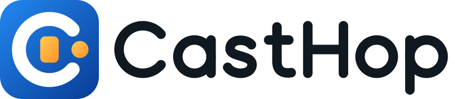

<picture>
  <source media="(prefers-color-scheme: dark)" srcset="brand/casthop-logo-on-dark.svg">
  
</picture>

# CastHop

**Mirror a tablet or phone wirelessly to smart boards, TVs and computers.**
Easy to set up, open source, low latency, encrypted.

[Türkçe](README.md) · [Install](#install) · [Use](#use) · [Troubleshooting](#troubleshooting) ·
[Architecture](docs/ARCHITECTURE.md) · [Protocol](docs/PROTOCOL.md) · [Changelog](CHANGELOG.md)

| Sender ↓ / Receiver → | Pardus board | Android TV, Google TV, Fire TV | Apple TV | Windows | Mac | iPad, Android tablet |
|---|---|---|---|---|---|---|
| Android tablet and phone | ✓ | ✓ | ✓ | ✓ | ✓ | ✓ |
| iPhone and iPad | ✓ | ✓ | ✓ | ✓ | ✓ | ✓ |

Both ends need CastHop. AirPlay, Miracast and Chromecast are not supported.

## What it does

Shows everything on the teacher's tablet — lesson apps, videos, photos, handwritten notes — with sound on the
classroom whiteboard. No cable, account or internet needed; the tablet and the board just need to be on the same
network.

- **1080p, 60 fps**; quality adapts to the network automatically and latency never builds up.
- **Sound**: video and app audio from the board's speakers, in sync with the picture.
- **Secure**: TLS 1.3; the board only accepts a tablet that knows the QR code / code on its screen. If another tablet
  wants to take over, the board asks for **approval**.
- **Easy**: scan the QR once, then one tap on the board's name. Short Wi-Fi drops recover automatically; rotating the
  tablet rotates the picture.
- **Camera**: sends the camera instead of the screen, one button for showing books, notebooks and papers.

## Install

### Board (Pardus ETAP 23 / Debian 12)

**Easiest:** open [ozkanceng.github.io/casthop](https://ozkanceng.github.io/casthop/) on the board and the tablet and follow the steps. On the board, double-click the downloaded `.deb` and install it with the administrator password.

Without an administrator password, install for your own account only:

```bash
wget -nv --tries=10 --retry-connrefused --waitretry=5 -O- https://ozkanceng.github.io/casthop/kur | sh
```

To download files by hand, use one of these from [Releases](https://github.com/ozkanceng/casthop/releases):

**A. Package (recommended, needs the administrator password)**

```bash
sudo apt install ./casthop_*_amd64.deb
```

**CastHop** appears in the menu. Dependencies (Qt, GStreamer) come from the Pardus repository.

**B. Portable (no administrator password)**

```bash
tar xf casthop-*-x86_64.tar.gz
cd casthop-*-x86_64
./install-user.sh
```

It installs into `~/.local/opt/yansit` and adds a menu entry.

> Optionally enable **Settings → "Start CastHop when the board starts"** on the board.

### Tablet (Android 10 or later)

Download `casthop-*.apk` from [Releases](https://github.com/ozkanceng/casthop/releases) on the tablet and open it.
Android may ask to allow installing from unknown sources the first time.

### TV, Windows and Mac

| Device | File | Note |
|---|---|---|
| Android TV, Google TV, Fire TV, Android tablet | `casthop-tv.apk` | On a TV, install it with a file manager or `adb install`. |
| Windows 10 and 11 (64-bit) | `casthop-setup-x86_64.exe` | Unsigned builds trigger SmartScreen: "More info" → "Run anyway". |
| Mac (macOS 14 or later) | `casthop-mac.dmg` | Without Apple's approval it warns on first launch: System Settings → Privacy & Security → "Open Anyway". |

All are on the [Releases](https://github.com/ozkanceng/casthop/releases) page.

### iPhone, iPad and Apple TV

Available once listed on the App Store. To build as a developer, run `xcodegen` in [`apple/`](apple/) and open
`CastHop.xcodeproj`.

## Use

1. Open **CastHop** on the board. A large QR code and a 6-digit code appear.
2. On the tablet open **CastHop**, tap **Connect to board** and scan the QR code.
3. Answer **Start** to Android's "Share your screen?" prompt. Done.

Stop from the tablet (**Stop mirroring** or **Stop** in the notification) or by tapping the board and pressing
**Stop mirroring**. **Pause** keeps the last picture on the board while you do something else on the tablet.

Boards you have connected to are listed under **Remembered boards**; next time, one tap is enough. Without the camera,
use **Connect with code** to pick the board on the network and enter its 6-digit code.

## Troubleshooting

| Symptom | Fix |
|---|---|
| "Cannot reach the board" | Are the tablet and board on the same Wi-Fi? Many school networks block devices from seeing each other (*client isolation*). Easiest fix: turn on the tablet's **mobile hotspot**, connect the board to it and scan the new QR. |
| "CastHop is not running on the board" | Open CastHop on the board. If it is open, allow TCP port 47800 in the board's firewall. |
| "The QR code is no longer valid" | Each QR code works once; scan the current one. |
| "Different networks" | Connect the tablet to the board's Wi-Fi or use the hotspot method. |
| Stutter / blur | Tablet **Settings → Picture quality → Balanced** or **Weak network**. Prefer 5 GHz Wi-Fi. |
| No sound | Was the sound permission granted, and is **Settings → Play sound on the board** on? Some apps do not allow their audio to be shared. |
| Mirroring stops when the screen locks | A security rule on Android 15+; increase the screen timeout. |

Help and bug reports: [Issues](https://github.com/ozkanceng/casthop/issues) — include `casthop --verbose`
output and the tablet model.

## Measured performance

From automated tests (every change, CI) and the soak test (30 min nightly); on-device measurements are collected with
the checklists in [docs/TESTING.md](docs/TESTING.md).

| Measurement | Result | Target |
|---|---|---|
| First frame after connecting | 50–90 ms (software decoder, CI) | ≤ 1 s |
| Capture→display, same machine | ≈ 1–5 ms (CI) | — |
| Recovery after a Wi-Fi drop | ≈ 20 ms once the network is back (CI) | ≤ 3 s |
| Rotation | reconfiguration without frame loss (CI) | < 1 s |
| Narrow link (2.5 Mbps) | latency < 800 ms, no build-up (CI) | no build-up |
| Audio/video skew | ≈ 22 ms (CI) | ≤ ±60 ms |
| 30-minute soak (video + audio) | latency slope 0.04 ms/min, memory growth 0.0%, 0 frames lost at the receiver, 0.05% late audio ([chart](docs/soak-30min.svg)) | slope ≈ 0, RSS < 5% |
| End-to-end (tablet → board, 5 GHz, 1080p60) | to be measured on devices ([how](tools/latency/README.md)) | ≤ 80 ms (acceptable ≤ 120 ms) |

## Components

| Directory | Content |
|---|---|
| [`android/`](android/) | Sender (`app`) and TV and tablet receiver (`tv`, `receiver-core`): Kotlin, Jetpack Compose, Android 10+ |
| [`apple/`](apple/) | iPhone and iPad sender; Mac, Apple TV and iPad receiver: Swift, iOS 17, tvOS 17, macOS 14 |
| [`receiver/`](receiver/) | Board and Windows receiver (C++20, Qt 6, GStreamer), Pardus ETAP 23 / Debian 12, Windows 10+ |
| [`protocol/`](protocol/) | Protocol test vectors and an independent reference generator |
| [`tools/`](tools/) | Fake sender and receiver, receiver conformance test, end-to-end tests, network simulation, latency measurement, soak test |
| [`web-receiver/`](web-receiver/) | (Next phase) browser receiver, no install |
| [`docs/`](docs/) | Plan, architecture, protocol, risks, on-device test checklists |

## Development

See [CONTRIBUTING.md](CONTRIBUTING.md); releases and APK signing: [docs/RELEASING.md](docs/RELEASING.md).

## License

[Apache-2.0](LICENSE). Third-party components: [docs/THIRD_PARTY.md](docs/THIRD_PARTY.md).
