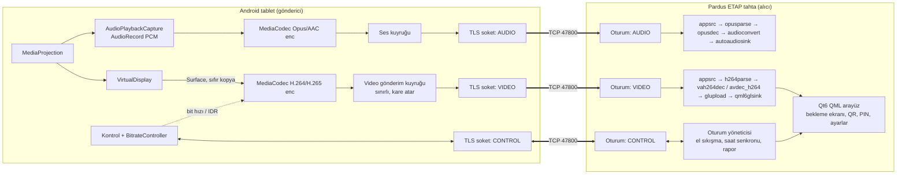
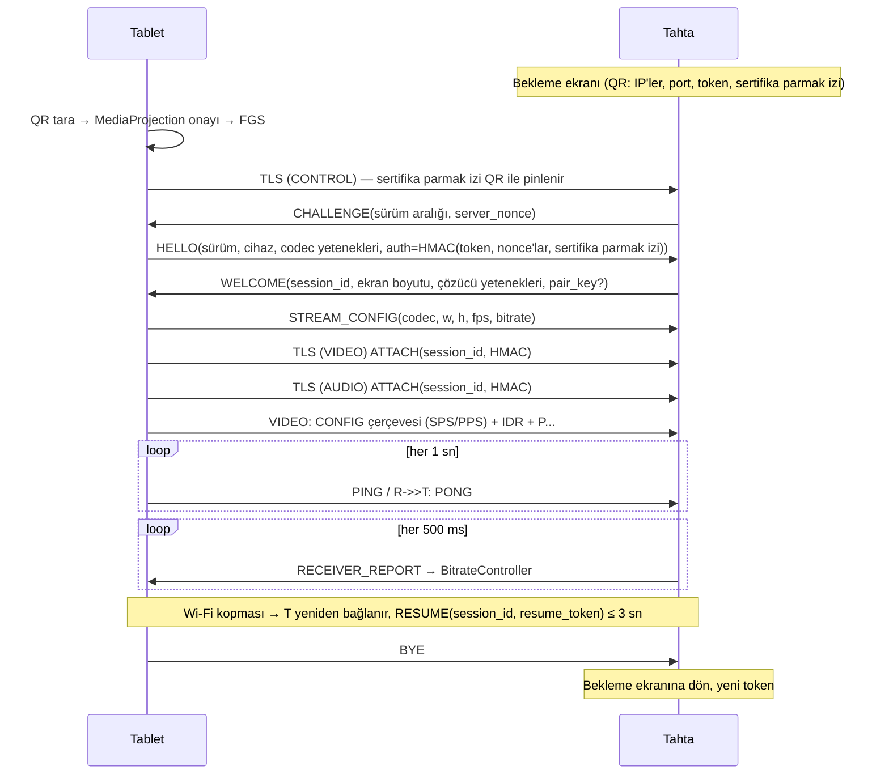

# CastHop — Mimari

## 1. Genel bakış



Tek dinleme portu, üç TLS bağlantısı (CONTROL, VIDEO, AUDIO). İlk bağlantı CONTROL'dür; el sıkışma bitince alıcı bir `session_id` verir, VIDEO/AUDIO bağlantıları bu kimlik + HMAC ile oturuma bağlanır. Ayrı bağlantılar, bir akıştaki büyük anahtar karenin kontrol mesajlarını ve sesi bekletmesini (head-of-line blocking) önler.

## 2. Bileşenler

### 2.1 Android gönderici (`/android`)

| Modül | Sorumluluk |
|---|---|
| `:protocol` | Saf Kotlin/JVM. Çerçeve kodlama/çözme, kontrol mesajları (TLV), el sıkışma durum makinesi, HMAC, saat senkronu, `BitrateController`. Android bağımlılığı yok → JVM'de test edilir, `tools/fake-sender` de kullanır. |
| `:app` | Compose UI, izin akışı, QR tarama, `MirrorService` (FGS), capture/encode/net katmanları. |

**İş parçacıkları (Coroutines + ayrılmış thread'ler):**
- `encoder-video`: `MediaCodec` async callback'leri ayrı `HandlerThread` üzerinde; çıktı `ByteBuffer` → kopyalanıp çerçevelenir → kuyruğa.
- `net-video`, `net-audio`, `net-control`: her soket için `Dispatchers.IO` üzerinde tek yazıcı coroutine; okuma ayrı.
- `audio-capture`: `AudioRecord.read` döngüsü (yüksek öncelikli thread).

**Video yakalama/kodlama ayrıntıları**
- `MediaCodec.createPersistentInputSurface()` → `VirtualDisplay` bu Surface'a çizer. Döndürmede: `virtualDisplay.resize(w,h,dpi)` → `codec.stop()` → `configure(yeniFormat)` → `setInputSurface(kalıcı)` → `start()`. VirtualDisplay asla yeniden oluşturulmaz (Android 14+ token kuralı). Kalıcı Surface'ın sorunlu olduğu cihazlarda yedek: yeni codec + `virtualDisplay.setSurface()`.
- Format anahtarları (yetenek sorgusuyla desteklenenler): `KEY_BITRATE_MODE` (CBR varsayılan, VBR seçenekli; `isBitrateModeSupported`), `KEY_I_FRAME_INTERVAL` (10 sn; gereken her durumda IDR ayrıca istenir, periyodik IDR yalnız havada ani yük yaratır), `KEY_REPEAT_PREVIOUS_FRAME_AFTER` (statik ekranda 100 ms), `KEY_PRIORITY=0` (realtime), `KEY_LATENCY=1`, `KEY_MAX_B_FRAMES=0`, `KEY_PREPEND_HEADER_TO_SYNC_FRAMES=1` (API 29; SPS/PPS her IDR önünde), `KEY_PROFILE/KEY_LEVEL` (High → yoksa Main → Baseline), `KEY_OPERATING_RATE`, `KEY_MAX_FPS_TO_ENCODER`.
- Çalışma anı: `PARAMETER_KEY_REQUEST_SYNC_FRAME` (yeni alıcı, tıkanıklık sonrası, alıcı isteği), `PARAMETER_KEY_VIDEO_BITRATE` (uyarlama).
- Yetenek sorgusu: `MediaCodecList(REGULAR_CODECS)` → `isEncoder && isHardwareAccelerated` → `VideoCapabilities.areSizeAndRateSupported`, `bitrateRange`, `profileLevels`, `widthAlignment/heightAlignment`. Arayüz yalnız desteklenen kombinasyonları gösterir.
- Çözünürlük: alıcının bildirdiği ekran boyutuna ve ön ayar tavanına sığacak şekilde en-boy korunarak ölçeklenir, hizalamaya yuvarlanır.

**Ön ayarlar** (cihaz/alıcı yeteneğiyle kırpılır)

| Ön ayar | Çözünürlük tavanı | FPS | Bit hızı başlangıç / tavan / taban |
|---|---|---|---|
| En iyi kalite | 1920 uzun kenar (Android'de gelişmiş ayar dahil üst sınır; iOS'ta alıcı 4K + kodlayıcı izin verirse 2560) | 60 | 16 / 24 / 4 Mbps |
| Dengeli | 1600 | 60 | 8 / 12 / 2 Mbps |
| Zayıf ağ | 1280 | 30 | 3 / 5 / 0,8 Mbps |

**Gönderim kuyruğu ve canlılık**
- Video kuyruğu en fazla ~2 kare veya 50 ms bekleyen veri tutar. Aşılırsa: kuyruktaki tüm P-kareler atılır, `DROP` sayacı artar, kodlayıcıdan IDR istenir, sonraki IDR'ye kadar P-kareler gönderilmez (H.264 P-kareleri referans olduğundan tek tek atılamaz). Aynı anda `BitrateController`'a tıkanıklık olayı bildirilir.
- **Anahtar kare koruması (`KeyframeGate`):** tıkalı ağda büyük bir IDR yazılırken arkasındaki P-kareler atılır ve bu yeni bir IDR isteği doğurur. Önceki IDR yazılırken gelen istekler bekletilir, yazım bitince tek IDR istenir; 1 sn zaman aşımı görüntünün donup kalmasını önler. Yeniden bağlanma ve duraklatma sonrası zorunlu IDR'ler bu kapıdan geçmez.
- VIDEO soketinin `SO_SNDBUF` değeri güncel bit hızının ≈ 100 ms'si kadar tutulur (32–512 KiB, bit hızı değiştikçe güncellenir) ki çekirdek tamponu kuyruk görevi görmesin; `TCP_NODELAY` açık.
- **Gecikme bütçesi:** alıcının bildirdiği yakalama→alım gecikmesi 300 ms'yi aşarsa (ağ, kodlayıcının en düşük bit hızında bile yetmiyor; yoldaki AP/vekil tamponları dolu) gönderim bütçeyi aşan süre kadar (en fazla 1 sn) kesilir, bekleyen kareler atılır ve IDR ile devam edilir. Böylece gecikme hiçbir koşulda birikmez.
- **Wi-Fi güç tasarrufu:** yansıtma boyunca `LowLatencyWifi` kilit tutar; radyo uyursa gecikme sıçramaları kodlayıcıdan bağımsız oluşur.
- **Canlılık ve RESUME:** 2,5 sn tahtadan hiçbir mesaj gelmezse bağlantı kopmuş sayılır; RESUME (≤ 10 sn pencere) → VIDEO yeniden ATTACH → son CONFIG yeniden gönderilir → hemen IDR. Pencere kaçarsa ve tahta hatırlanıyorsa eşleştirme anahtarıyla yeni oturum açılır (yakalama ve VirtualDisplay korunur).

**BitrateController** (saf mantık, birim testli): girdiler = gönderici kuyruk gecikmesi, alıcı raporu (tahmini tek yön gecikme eğimi, geç kare oranı, alınan bit hızı). AIMD: tıkanıklık → ×0,7 (en sık 500 ms'de bir); 2 sn kararlı → tıkanıklık öncesi hızın %85'ine dek +%31/sn, sonra +%8/sn tavana kadar. Ayrıntı: [PROTOCOL.md §7.6](PROTOCOL.md).

**QualityGovernor** (saf mantık, birim testli): bit hızı tabana indiği hâlde tıkanıklık sürerse çözünürlük ve kare hızı da düşmelidir. Bit hızı tabandayken 3 sn geçerse bir alt ön ayara inilir, 60 sn kararlı ve tavanın %90'ındaysa bir üst ön ayara çıkılır. Yükseldikten sonraki 30 sn içinde yine inerse bekleme iki katına çıkar (en çok 480 sn). Son geçişten sonra inmek için en az 5 sn, çıkmak için en az 15 sn beklenir: yavaş ağda En iyi kaliteden Zayıf ağ'a yaklaşık 10 sn'de inilir. Her geçişte ulaşılan ön ayar alıcının sertifika parmak iziyle saklanır (Android `BoardStore`, iOS `SharedStore` `presets.json`); sonraki oturum oradan başlar, ağ iyiyse bugünkü gibi yükselir. Seçilen ön ayara dönülünce kayıt silinir. Öğretmenin seçtiği ön ayar tavandır, `StreamOverrides` verilmişse governor kapalıdır. Geçiş `MirrorController.stepQuality` ile yapılır: `VirtualDisplay` yalnız `resize` edilir, kodlayıcı `reconfigure` ile yeniden kurulur. Etkin ön ayar `Capture` içinde tutulur; döndürme otomatik düşüşü geri almaz. Eşikler tasarım tahminidir.

**Ses:** `AudioPlaybackCaptureConfiguration` (USAGE_MEDIA, USAGE_GAME, USAGE_UNKNOWN) + `AudioRecord` 48 kHz stereo PCM16 → `MediaCodec` Opus (API 29 yazılım kodlayıcısı; çalışma anında doğrulanır) 20 ms paket, 128 kbps; yoksa AAC-LC. Zaman damgası `AudioRecord.getTimestamp(TIMEBASE_MONOTONIC)` → videoyla aynı `CLOCK_MONOTONIC` tabanı. CONFIG yükü (OpusHead / AudioSpecificConfig) kodlayıcının özel CSD biçimine bağlı kalmamak için parametrelerden üretilir.

**Alıcıda ses zamanlaması:** ses boru hattı sistem monotonik saatini ve sıfır temel zamanı kullanır (çalışma zamanı = `CLOCK_MONOTONIC`); paketin PTS'i göndericideki yakalama anı + saat ofsetidir, boru hattı gecikmesi = hedef ses gecikmesi. Hedef, görüntünün yakalama→çizim ortalaması + bir ekran karesi olarak her raporda güncellenir (en az 40, en çok 250 ms) → ses, görüntü ekrana çıktığında çalar. Zamanında çalınamayacak paket atılır ve RECEIVER_REPORT `audio_late` ile bildirilir. Saat ofsetinin hızla oturması için gönderici ilk PING'leri 50 ms aralıkla yollar.

**Kamera modu:** ekran yerine kamera gönderilir. `CameraCapture` Camera2 ile tek oturumda iki çıkış açar: kodlayıcı yüzeyi ve öğretmenin önizlemesi. MediaProjection ve onay ekranı gerekmez; servis `camera` türüyle ön plana geçer. Kamera çıktı boyutu oturum boyunca sabittir, bu yüzden `QualityGovernor` ön ayar değiştirmez, yalnız bit hızı uyarlanır. Görüntü kodlamadan önce döndürülmediği için ekran yatay kilitlenir. Ses gönderilmez: uygulama sesi yakalama MediaProjection ister.

**Servis ve yaşam döngüsü:** onay sonucu → `MirrorService` başlat → `ServiceCompat.startForeground(..., FOREGROUND_SERVICE_TYPE_MEDIA_PROJECTION)` → `getMediaProjection()` → `registerCallback()` → `createVirtualDisplay()` (bir kez). `onStop()` → kaynakları bırak, alıcıya `BYE(reason=projection_stopped)`, arayüzde "Yansıtma durdu — tekrar başlat".

**UI (Compose):** Ana ekran tek büyük buton; bağlantı sırasında durum kartı (gecikme/FPS/bit hızı), Duraklat/Durdur; hatırlanan tahtalar listesi; ayarlar (ön ayar, gelişmiş, ses, tema, dil). TR varsayılan, EN; Material 3 dinamik/karanlık tema.

**QR tarama:** CameraX + `zxing-cpp` Android sarmalayıcısı (Apache-2.0, Google Play Hizmetleri gerektirmez → F-Droid uyumlu).

### 2.2 Pardus alıcı (`/receiver`)

**Teknoloji seçimi: C++20 + Qt 6.4 (QML) + GStreamer 1.22** — gerekçe §8.

| Katman | Sınıflar (plan) |
|---|---|
| `protocol/` (Qt'siz, STL) | `FrameCodec`, `ControlTlv`, `Handshake`, `ClockSync`, `Hmac` (OpenSSL) |
| `net/` | `Server` (`QSslServer`, Qt 6.4+; OpenSSL 3 arka ucu), `Session`, `PeerConnection` |
| `media/` | `VideoPipeline`, `AudioPipeline`, `DecoderProbe` (VA/HEVC yetenek tespiti), `Screenshot` |
| `app/` | `PairingManager` (token/PIN/güvenilir göndericiler), `NetInfo` (arayüz IP'leri), `Settings`, `Autostart`, `MdnsPublisher` (Avahi client) |
| `qml/` | `WaitingScreen`, `MirrorView`, `ControlBar`, `SettingsPanel`, `TakeoverDialog`, `PausedOverlay` |

**Video pipeline**

```
appsrc name=src is-live=true format=time do-timestamp=false
       caps="video/x-h264,stream-format=byte-stream,alignment=au"
  ! h264parse config-interval=-1
  ! <decoder>
  ! queue leaky=downstream max-size-buffers=2 max-size-time=0 max-size-bytes=0
  ! glupload ! glcolorconvert
  ! qml6glsink name=sink sync=false enable-last-sample=true
```

- `<decoder>`: `DecoderProbe` sırası → `vah264dec` (VA, plugins-bad) → `vaapih264dec` (eski) → `avdec_h264 max-threads=N` (yazılım). H.265 için `vah265dec` → `avdec_h265`; HEVC yalnız VA ile çözülebiliyorsa göndericiye ilan edilir.
- VA çözücülerde `compliance=flexible`: göndericide B-kare yok, kareler sıra değiştirmez; varsayılanda High profil canlı akış bir sonraki kareyi bekler.
- Video `sync=false`: kare çözülür çözülmez çizilir (canlılık > akıcılık). Çözücü önünde sıkışma: `Session`, decoder'a verilmemiş sıkıştırılmış veri > 3 kare ise sonraki IDR'ye kadar atar ve `KEYFRAME_REQUEST` gönderir.
- Ölçekleme (sığdır/doldur): `qml6glsink` QML `GstGLQt6VideoItem` üzerinde `fillMode` / `force-aspect-ratio`.
- Ekran görüntüsü: `last-sample` → `gst_video_convert_sample(..., image/png)` → `~/Resimler/CastHop/`.

**Ses pipeline**

```
appsrc is-live=true format=time ! opusparse ! opusdec plc=true
  ! audioconvert ! audioresample ! autoaudiosink sync=true
```
Zaman damgası eşleme: `pts_alıcı = pts_gönderici + saat_ofseti + D`. `D` = ölçülen video yolu gecikmesinin EWMA'sı (20–150 ms'ye kırpılır) → ses görüntüyle hizalanır. Ses > 80 ms gecikirse paketler atlanır (`discont`).

**Zaman ve saat:** `ClockSync` CONTROL üzerinde 1 sn'de bir PING/PONG (4 zaman damgası, NTP formülü), son 8 örnekte en düşük RTT'li ofset seçilir. Alıcı ölçümleri (tek yön gecikme, geç kare) bu ofsetle hesaplanır.

**UI/UX:** Bekleme ekranı tam ekran: solda büyük QR, sağda 6 haneli PIN (büyük punto), "El ile bağlantı: 192.168.1.20 : 47800", tahta adı. Alt kenarda 72 px+ dokunmatik butonlar: Ayarlar, Tam ekrandan çık, Bağlantıyı kes, Ekran görüntüsü. Yansıtma sırasında kontroller 3 sn hareketsizlikte gizlenir, kenara dokununca görünür. Tasarım token'ları (renk, boşluk, tipografi) tek QML singleton'da; kontrast WCAG AA.

**Ağ arayüzleri:** `QNetworkInterface` → up + running + !loopback + IPv4 özel aralık (RFC1918 / link-local) adresler; Ethernet önce, sonra Wi-Fi, sonra diğerleri; QR'a en fazla 4 adres. Arayüz değişince (`QNetworkInformation` + 5 sn yoklama) QR yenilenir.

**mDNS:** Avahi client API ile `_yansit._tcp` yayını (TXT: `v=1`, `name=`, `fp=` sertifika parmak izi ilk 16 bayt). Avahi yoksa sessizce devre dışı.

**Paketleme:** `debian/` (debhelper-compat 13). Çalışma bağımlılıkları: `${shlibs:Depends}`, `gstreamer1.0-plugins-base`, `-good`, `-bad`, `gstreamer1.0-qt6`, `gstreamer1.0-gl`, `qml6-module-qtquick`, `qml6-module-qtquick-controls`, `qml6-module-qtquick-layouts`, `qml6-module-qtquick-window`; Recommends: `gstreamer1.0-libav`, `intel-media-va-driver | i965-va-driver | mesa-va-drivers`, `avahi-daemon`. Masaüstü dosyası, hicolor ikonları, isteğe bağlı otomatik başlatma (`~/.config/autostart/` kullanıcı ayarıyla yazılır/silinir).

### 2.2a Windows alıcısı (`/receiver`)
Pardus alıcısıyla aynı C++ kod. Platforma bağlı parçalar ayrılmıştır: mDNS Windows'ta `DnsServiceRegister`, otomatik başlatma kayıt defteri `Run` anahtarı, anahtar dosyası kullanıcı ACL'si. Çözücü `d3d11h264dec` ve `d3d11h265dec`, görüntü işlemci çizim yolundan geçer. Kurucu Inno Setup ile Qt ve GStreamer'ı içinde getirir, 47800 için güvenlik duvarı kuralı ekler (`.github/workflows/windows.yml`).

### 2.2b Android TV ve tablet alıcısı (`/android/receiver-core`, `/android/tv`)
`receiver-core` saf Kotlin/JVM'dir: `PairingManager`, `SessionManager`, `Connection`, rapor ve saat senkronu. `tools/fake-receiver` bu çekirdeği cihazsız çalıştırır. `tv` uygulaması TLS sunucusunu (`AndroidKeyStore`, `SSLServerSocket`), `MediaCodec` + `SurfaceView` görüntüyü, `AudioTrack` sesini ve `NsdManager` yayınını ekler. Kumanda ve dokunmatikle kullanılır.

### 2.2c Apple (`/apple`)
`CastHopKit` Swift paketi protokol, gönderici ve alıcı kodunu tutar; TLS `Network.framework` ile, parmak izi sabitlemelidir. Xcode projesi `project.yml`'den XcodeGen ile üretilir, commit edilmez.

- **Alıcı (macOS, tvOS, iPadOS):** `AVSampleBufferDisplayLayer` + VideoToolbox. `casthop-receiver` aynı kodu başsız çalıştırır.
- **Ekran gönderici (iOS, iPadOS):** uygulama eşleşmeyi App Group'a yazar, `RPSystemBroadcastPickerView` Broadcast Upload Extension'ı başlatır. Uzantı 50 MB bellek sınırına göre yazılmıştır: tek kodlayıcı, kare kopyası yok, kuyruk sınırlı. Durum Darwin bildirimleriyle uygulamaya gider.
- **Kamera gönderici (iOS, iPadOS):** uzantı kamerayı kullanamaz; `AVCaptureSession` uygulama içinde `BroadcastEngine`'e kare verir. Uygulama arka plana geçince iOS kamerayı aldığı için oturum biter.
- `casthop-sender` macOS CLI'si aynı oturum ve kodlayıcı kodunu dosyadan besler.

### 2.2d Alıcıların ortak kuralı
Üç alıcı (C++, Kotlin, Swift) `docs/PROTOCOL.md` §11'e uyar ve aynı `--headless --port --pairing-file --stats-file` sözleşmesini sağlar; `tools/conformance/run.py` hepsine aynı senaryoları çalıştırır. Ortak kod yerine üç uygulama seçildi: TLS sunucusu ve kimlik her platformda yeniden yazılacağı için paylaşılabilen yalnız oturum mantığı kalıyor, OpenSSL'i iki mobil platforma taşımaya değmiyor.

### 2.3 `/protocol`
`PROTOCOL.md`'nin makine-okur karşılıkları: `vectors/*.hex` (ham baytlar) + `vectors.json` (beklenen alanlar / beklenen hata). Her iki uygulamanın test paketi bu dizini okur.

### 2.4 `/tools`
- `fake-sender` (Kotlin/JVM): Annex-B H.264/H.265 + isteğe bağlı Opus (Ogg) dosyasından gerçek zamanlı akış; netem senaryoları için hız/çerçeve kontrolü.
- `fake-receiver` (Kotlin/JVM): `receiver-core` çekirdeğinin CLI'si; Android göndericiyi tahtasız test eder, çerçeveleri doğrular, istatistik basar.
- `conformance/`: alıcıdan bağımsız uyum testi (§2.2d).
- `latency/`: test deseni + ölçüm (§6).
- `soak/`: uzun süre testi betikleri.

### 2.5 `/web-receiver` (sonraki aşama)
Tablet içinde HTTP + WebSocket sunucu; tarayıcıda WebCodecs. Aynı çerçeve başlığı WS ikili mesajında taşınır.

## 3. Veri akışı ve oturum yaşam döngüsü



## 4. Güvenlik modeli

| Tehdit | Önlem |
|---|---|
| Sınıftaki öğrencinin tahtaya kendi ekranını yansıtması | Token (QR, 128 bit, tek kullanımlık) veya PIN (6 hane, tek kullanımlık, 5 hatalı denemede yenilenir + 30 sn kilit) olmadan HELLO reddedilir. |
| Aktif yayını kesip devralma | Aynı anda tek gönderici; yeni gönderici için tahtada "devralma onayı" diyalogu (dokunmatik). Onay yoksa 20 sn'de reddedilir. |
| Pasif dinleme (görüntünün ağda okunması) | TLS 1.3 (AES-GCM / ChaCha20-Poly1305). |
| Ortadaki adam (QR akışı) | Alıcının kendinden imzalı sertifikasının SHA-256 parmak izi QR'da → gönderici pinler. Kimlik kanıtı (HMAC) gönderici tarafından görülen sertifika parmak izine ve alıcının bağlantı başına nonce'una bağlanır → tekrar oynatma ve aktarma işe yaramaz. |
| Ortadaki adam (elle IP + PIN) | Pinleme yok (ilk eşleştirmede parmak izi kaydedilir, sonra pinlenir); PIN HMAC'i parmak izine bağlı olduğundan pasif saldırı ve basit aktarma başarısız. Aktif MITM'de 6 haneli PIN çevrimdışı kaba kuvvete açık → **bilinen zayıflık**, S6'da PAKE ile kapatılacak; arayüz QR'ı öne çıkarır. |
| Kalıcı eşleştirme anahtarının çalınması | Tabletde Android Keystore ile şifreli DataStore; tahtada `~/.local/share/yansit/trusted.json` 0600. Ayarlardan silinebilir. |

**TLS'in gecikmeye etkisi:** El sıkışma oturum başına bir kez (~1 RTT, TLS 1.3). Kayıt başına yük 22 bayt + AEAD; 16 Mbps'de AES-GCM donanım hızlandırmalı ARMv8/x86'da CPU < %1, eklenen gecikme mikro-saniye mertebesinde. Bayt sayısı kayıt sınırıyla değil çerçeve yazımıyla belirlenir; `TCP_NODELAY` ile her çerçeve hemen gider. **Sonuç: TLS varsayılan açık.** M7 ölçümünde TLS kapalı geliştirici modu (yalnız debug derlemesi) ile karşılaştırma yapılır.

## 5. Ağ teşhisi ve hotspot

Bağlanma algoritması (gönderici): QR'daki tüm IP'lere paralel TCP bağlantısı (ilk başarılı kazanır, 3 sn zaman aşımı).
- `ECONNREFUSED` → "Tahtada CastHop açık değil".
- Tümü zaman aşımı + tablet IP'si QR'daki bir adresle aynı alt ağda → **"Okul ağı cihazların birbirini görmesini engelliyor olabilir (istemci izolasyonu). Tabletin hotspot'unu açıp tahtayı ona bağlayın."** + adım adım görsel rehber.
- Farklı alt ağ → "Tablet ve tahta farklı ağlarda".
- Android 17'de izin reddi → izin ekranına yönlendir.

Hotspot senaryosu: tablet "Kişisel hotspot"u açar; tahta bu ağa Wi-Fi ile bağlanır (Ethernet kablolu internet varsa korunur); tahtanın bekleme ekranı yeni IP ile QR'ı otomatik yeniler. İleride: alıcıda NetworkManager D-Bus üzerinden hotspot SSID/şifre girişi.

## 6. Gecikme bütçesi ve ölçüm

| Aşama | Hedef |
|---|---|
| Yakalama + kodlama (donanım) | 10–20 ms |
| Paketleme + TLS + gönderim kuyruğu | < 2 ms |
| Wi-Fi 5 GHz iletim | 3–10 ms |
| Çözme (VA) | 3–8 ms |
| GL yükleme + çizim + vsync (60 Hz) | 8–17 ms |
| **Toplam yazılım yolu** | **≈ 30–60 ms** |
| Tahta paneli giriş gecikmesi (bizim kontrolümüz dışında) | 10–50 ms |

Ölçüm: (a) **otomatik**: tablette test deseni her karede monotonik zamanı ikili şerit olarak çizer; alıcı çözülen karedeki şeridi okur, `ClockSync` ofsetiyle farkı hesaplar → kodlamadan çizime kadarki yol. (b) **göz-cama**: iki ekranda ms saati, tek fotoğraf (yüksek hızlı kamera) — panel gecikmesini de içerir. README'ye ikisi de yazılır.

## 7. Hata yönetimi

- `MediaCodec.Callback.onError` / `CodecException.isRecoverable/isTransient` → yeniden yapılandırma; 3 başarısız denemede bir alt ön ayara düş (ağ kaynaklı geçişler için §2.1 QualityGovernor); yine olmazsa kullanıcıya mesaj.
- Alıcıda GStreamer `ERROR` mesajı → pipeline yeniden kurulur, VA hatası iki kez tekrarlarsa yazılım çözücüye geçilir, göndericiden IDR istenir.
- Tüm protokol ayrıştırma hataları tanımlı `ErrorCode` döndürür; bağlantı kapatılır, uygulama çökmez.

## 8. Teknoloji seçimleri ve gerekçeler

| Karar | Seçim | Alternatif | Gerekçe |
|---|---|---|---|
| Alıcı dili/çatısı | **C++20 + Qt 6.4 QML + GStreamer 1.22** | Rust + gstreamer-rs + GTK4 | Tüm bağımlılıklar Debian 12 deposundan → küçük .deb, `apt` ile bağımlılık çözümü, Pardus'un güvenlik güncellemeleri. `qml6glsink` bookworm'da paketli. Rust yolu için bookworm'un rustc'si (1.63) eski; `gtk4paintablesink` (gst-plugins-rs) bookworm'da yok → gömülmesi gerekir. QML dokunmatik/büyük ölçekli arayüz için uygun. |
| Taşıma | **TCP + TLS 1.3**, 3 bağlantı | UDP/RTP | İstenen; okul ağlarında güvenilir; HOL bloklamayı ayrı bağlantı + gönderici kare atma çözer. Hedef tutmazsa S5. |
| Kontrol mesaj kodlaması | **İkili TLV** | JSON / protobuf | Bayt düzeyinde belgelenebilir, iki dilde bağımlılıksız, ileri uyumlu (bilinmeyen etiket atlanır), WebCodecs alıcısında JS ile kolay. |
| Video codec | **H.264 varsayılan**, H.265 opsiyonel | AV1 | Her tablette donanım kodlayıcı ve her tahtada (Intel Gen7+) VA çözücü var. AV1 kodlama/çözme donanımı okul donanımında yok. |
| Ses codec | **Opus** (yoksa AAC-LC) | — | Düşük gecikme (20 ms çerçeve), Android 10+ kodlayıcı, GStreamer'da `opusdec`. |
| QR okuma | CameraX + zxing-cpp | ML Kit | GMS bağımsız, açık kaynak. |
| Alıcı QR üretimi | libqrencode | gömülü kütüphane | Debian paketi, LGPL dinamik bağlantı Apache-2.0 ile uyumlu. |
| Android hedef | minSdk 29, target/compile 37 | target 36 | "En güncel kararlı" isteği; Android 17 yerel ağ izni bilinçli olarak ele alınır. |

## 9. Doğrulanmış sürümler ve kaynaklar

| Bilgi | Değer | Kaynak |
|---|---|---|
| Android 17 kararlı | API 37, 2026-06 | [issoh.co.jp](https://www.issoh.co.jp/md/tech/10993), [ecorpit](https://ecorpit.com/android-target-api-36-play-store-deadline-migration-2026/) |
| Play target zorunluluğu | API 36, 2026-08-31 | aynı |
| Yerel ağ izni | `ACCESS_LOCAL_NETWORK`, target 37'de zorunlu, NEARBY_DEVICES grubu | [developer.android.com/privacy/local-network-permission](https://developer.android.com/privacy/local-network-permission) |
| MediaProjection kuralları, kilitlenince durma (15 QPR1+), resize callback | — | [developer.android.com/media/grow/media-projection](https://developer.android.com/media/grow/media-projection) |
| Pardus 23 tabanı | Debian 12 | [pardus.org.tr 23.0 sürüm notu](https://pardus.org.tr/en/pardus-23-0-release-note/) |
| bookworm paketleri | GStreamer 1.22.0, Qt 6.4.2, CMake 3.25.1, OpenSSL 3.0, qrencode 4.1.1, Avahi 0.8 | sources.debian.org API, [packages.debian.org](https://packages.debian.org/bookworm/gstreamer1.0-plugins-base) |
| `gstreamer1.0-qt6` bookworm | 1.22.0-5+deb12u4 | packages.debian.org |
| `vah264dec` rank | primary + 1 | [gstreamer.freedesktop.org](https://gstreamer.freedesktop.org/documentation/va/vah264dec.html) |

Android derleme araçları (AGP, Kotlin, Compose BOM, CameraX, zxing-cpp) M0'da Maven depolarından **kararlı** sürümlere sabitlenir (ön sürümler kullanılmaz).
